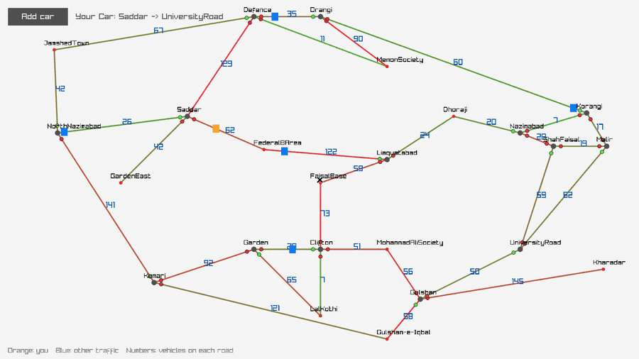
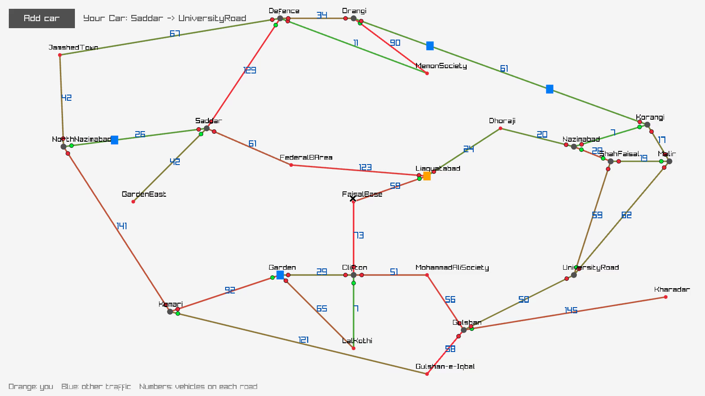

# Traffic Congestion Control System

A real-time traffic simulation of Karachi in C++ with [raylib](https://www.raylib.com/). Vehicles find routes with **A\*** over a road graph in which every car on a road makes it more expensive, and they re-plan at every junction. Intersections cycle their signals, so vehicles queue at red lights.

[](https://github.com/Abdul-Wahab-17/TrafficSystem/actions/workflows/ci.yml)
[](LICENSE)



## How it works

- **Road network.** 24 locations: 10 neighbourhoods and 14 signalled intersections (4-way and 3-way), joined by 32 two-way roads. Each road's capacity comes from its width × length.
- **Congestion-aware routing.** A road's cost is `length + 10 × vehicles on it`, and the A\* heuristic is straight-line distance. A vehicle only commits to the next road, then plans again when it reaches the next node, so it steers around jams that form while it drives.
- **Traffic signals.** Each intersection gives one approach a green light at a time and rotates every 10 seconds. A vehicle that reaches an intersection waits until its road is green.
- **Live view.** Roads shade from green to red as they fill up, and the number on each road is its current vehicle count. Your vehicle is orange and other traffic is blue. **Add car** spawns a car between two random locations.



## Build

You need CMake 3.16+ and a C++17 compiler. raylib 5.5 is downloaded and built automatically if it isn't installed.

**Linux:** first install the X11/GL headers raylib needs. On Debian/Ubuntu:

```bash
sudo apt install build-essential cmake libx11-dev libxrandr-dev libxinerama-dev libxcursor-dev libxi-dev libgl1-mesa-dev
```

**Windows:** Visual Studio 2022 with the "Desktop development with C++" workload includes CMake.

Then:

```bash
cmake -S . -B build -DCMAKE_BUILD_TYPE=Release
cmake --build build --config Release
```

## Test

```bash
ctest --test-dir build --output-on-failure
```

The tests cover shortest-path routing, rerouting around a congested road, unreachable destinations, signal cycling and a vehicle driving a route to its destination.

## Run

```bash
./build/traffic_system              # interactive: pick a vehicle, start and destination
./build/traffic_system 2 12 24      # Car from Saddar (12) to UniversityRoad (24)
```

On Windows, the executable is `build\Release\traffic_system.exe`.

Arguments are `vehicle start destination`. Vehicles: 1 Rickshaw, 2 Car, 3 Bike, 4 Truck, 5 Other. The interactive menu lists the location numbers. The window can be resized and the map scales to fit. Press **Esc** to quit.

## Project structure

```text
include/graph.hpp     Node, TrafficIntersection, Edge, A* declarations
tests/test_core.cpp   unit tests (ctest)
src/graph.cpp         road graph, signal cycling, cost function and A* search
include/vehicle.hpp   Vehicle
src/vehicle.cpp       movement, re-planning, road occupancy
src/main.cpp          Karachi map, console menu, raylib render loop
```

## License

[MIT](LICENSE) © 2026 Abdul Wahab
